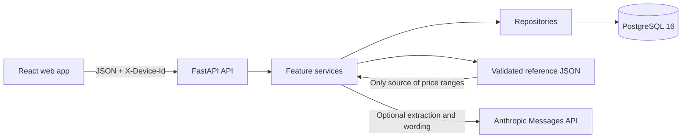

# Pet&GO

Pet&GO is the money co-pilot for US dog and cat owners. It forecasts yearly care costs, explains every priced line in a vet estimate, and turns preventive care into simple daily and weekly quests.

> Production link: pending deployment. Replace this line with the public HTTPS URL before submission.

## Run locally

Requirements: Docker with Compose and GNU Make.

```bash
cp .env.example .env
make up
make migrate
```

The frontend is served at `http://localhost:5173`. The API health check is available at `http://localhost:8000/api/health` in development.

## Architecture



The repository is organized by feature. FastAPI routers handle HTTP, services own business rules, and repositories are the only layer that builds database queries. The React app keeps server state in TanStack Query and sends all requests through one API client.

## Estimate decoder

The decoder keeps price decisions deterministic:

1. The optional LLM extracts descriptions and charged amounts as validated JSON. If the key is absent or the request fails, a regex parser finds priced lines.
2. Python normalizes clinic abbreviations such as `DHPP`, `CBC/Chem`, `dental prophy`, and `full-mouth rads` before matching aliases and applying a similarity threshold.
3. Code compares the charge with `prices.json` and assigns `within`, `above`, `below`, or `unknown`. The LLM never supplies a price or verdict.
4. The optional LLM writes a short explanation and a cost-focused question. Deterministic templates cover any failure.
5. Successful results are stored. A failed decode with no priced lines does not consume the free decode.

The decoder always displays: **This is cost information, not veterinary advice.**

## Price data

Every reference price lives in [`backend/app/data/prices.json`](backend/app/data/prices.json) with its US source URL. The current dataset contains 40 common dog and cat services and products, with sources including:

- CareCredit and its 2025 Synchrony procedural cost study
- Pawlicy Advisor's November 2026 US veterinary price guide
- VetTally's 2026 dataset of 932 verified reports from 434 clinics
- University of Pennsylvania's published low-cost clinic handbook
- UConn School of Pharmacy's veterinary emergency cost guide
- Published clinic pricing for dental radiographs

Annual parasite-prevention rows equal 12 monthly doses from the linked monthly source range. Rows without a defensible source are left out; unmatched estimate lines return `range: null` and `No reference range`.

## No-login identity

There is no sign-up flow. On first load, the browser creates a UUID v4 in `localStorage["petgo:device"]` and sends it as `X-Device-Id` on each API request. The backend validates the UUID and upserts a user keyed by `device_id`. A future authentication system can replace that dependency without changing feature services.

## Configuration

Copy `.env.example` to `.env`. Never commit real credentials. The decoder works without `LLM_API_KEY` by using its regex and template fallbacks.

Important variables:

- `DATABASE_URL`
- `CORS_ORIGINS`
- `LLM_API_KEY`
- `LLM_MODEL` (defaults to `claude-haiku-5-5`)
- `DEBUG`
- `ENV`

## Checks

```bash
make lint       # Ruff, formatting, mypy, ESLint, Prettier, TypeScript
make test       # backend and frontend tests
make gen-api    # regenerate frontend types from FastAPI OpenAPI
make prod-up    # exercise the production Compose stack locally
```

After a database model change, create and review an Alembic migration, then test downgrade and upgrade before merging.

## Plans

Free includes a yearly category range, one estimate decode, daily care quests, and expense tracking. Paid plans add unlimited decoding, the month-by-month forecast, and the full quest set. Test-mode checkout offers `$59.99/year` or `$9.99/month`; it collects no card information and charges nothing.
