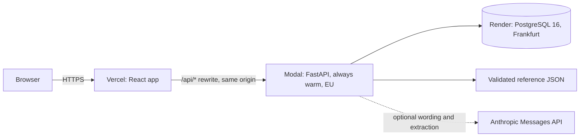

# Pet&GO

**The money co-pilot for pet owners.** Know what your pet will cost this year, check any vet estimate line by line, and build the small care habits that keep bills down.

**Live app: https://petgo-business-cup.vercel.app** (no sign-up, no login, works on a phone and a laptop)

Built in 24 hours for Business Cup 2.0 (AIESEC x Zimran x Nazarbayev University), Money track.

> Pet&GO explains costs. It does not give veterinary or medical advice.

---

## Try it in 60 seconds

1. Open the [live app](https://petgo-business-cup.vercel.app) and click **Try with a sample dog**.
2. See Biscuit's yearly forecast: a typical amount, a range, and where the money goes, with a source link on every price.
3. Click **Continue free**. On the dashboard, complete a care quest and watch XP and the streak move.
4. Open **Decode an estimate** and click **Use sample estimate**. Every line gets a verdict (within, above, below or no reference range), a plain-English explanation and a polite question to ask the vet.

Or click **Start with my pet** and answer 8 quick questions about your own dog or cat.

## The problem

**One user:** a US dog or cat owner aged 25-45 with a job and a budget, who treats the pet as family.

**One pain:** vet costs are unpredictable and opaque. The owner gets an estimate they cannot read, has no idea whether the prices are normal, and feels that questioning it means failing the pet. The result is surprise bills and debt.

- US pet spending was $158 billion in 2025, across 95 million pet-owning households ([APPA, 2026](https://citizenshipper.com/blog/press-room/whats-the-cost-to-own-a-pet/)).
- 39% of owners have gone into debt for pet medical care (same source).
- 62% would go into debt to save their pet's life ([Morning Consult for Money.com / Healthy Paws, 2026](https://www.healthypawspetinsurance.com/pet-insurance-research/love-vs-limits-the-new-economics-of-pet-care.html)).
- 29% of Gen Z and Millennial owners are in debt because of pet costs; 83% say the pet feels like their own child ([Harris Poll, 2026](https://theharrispoll.com/?p=28794)).
- Only 7% would cut pet health spending when money is tight, versus 33% who would cut digital subscriptions ([Elanco survey via dvm360, 2026](https://www.dvm360.com/view/consumers-say-pet-health-is-the-last-expense-theyd-cut-survey-finds)).

## What Pet&GO does

| | |
|---|---|
| **Forecast** | A yearly cost range for your pet, by category, adjusted for species, size, age and US state. Built from a care schedule by life stage and sourced US prices. Food is estimated separately. |
| **Decoder** | Paste a vet estimate. Each priced line is matched to a sourced reference range and gets a verdict. Questions for the vet are ready to copy. |
| **Grow** | Daily, weekly and monthly care quests grow the pet avatar (Puppy, Growing pup, Good dog). Quests show the typical cost of the problem they help prevent. |
| **Money** | Track vet bills and food purchases against the forecast. |

### What we sell

| Free | Paid: $59.99/year (default) or $9.99/month |
|---|---|
| Yearly cost range by category | Unlimited estimate decoding |
| 1 estimate decode | Month-by-month forecast |
| Daily care quests and expense tracking | Every daily, weekly and monthly quest |

Checkout is a clearly labeled **test mode**: no card fields, nothing is charged.

### Rules we hold ourselves to

1. No sign-up or login anywhere.
2. Nothing faked. Demo buttons load sample *input* from the API, then call the real API.
3. Prices come only from [`backend/app/data/prices.json`](backend/app/data/prices.json). The LLM never invents a price. No match means "No reference range".
4. The decoder always shows: *This is cost information, not veterinary advice.*
5. No "money saved" number unless it is computed from data the user entered.

---

## Architecture



- **Frontend:** React 18, TypeScript (strict), Vite, React Router, TanStack Query, Tailwind CSS, shadcn/ui, react-hook-form with zod.
- **Backend:** Python 3.12, FastAPI, Pydantic v2, SQLAlchemy 2 (async) with asyncpg, Alembic.
- **Database:** PostgreSQL 16.
- **Tooling:** uv, pnpm, Ruff, mypy (strict), ESLint, Prettier, pytest, Vitest, Docker Compose.

The code is organized by feature on both sides (`backend/app/features/<feature>`, `frontend/src/features/<feature>`). On the backend, routers handle HTTP only, services own the business rules, and repositories are the only place that builds database queries. Errors use one format: `{"error": {"code", "message", "details"}}`. On the frontend, all server state lives in TanStack Query and every request goes through one API client.

### No-login identity

There is no sign-up. On first load the browser creates a UUID v4 in `localStorage["petgo:device"]` and sends it as `X-Device-Id` on every API call. The backend validates it and upserts a user keyed by `device_id`. Real authentication can later replace that one dependency without touching the feature services.

### Estimate decoder

Price decisions are deterministic:

1. An optional LLM extracts descriptions and charged amounts as validated JSON. If the key is missing or the call fails, a regex parser finds the priced lines.
2. Python normalizes clinic shorthand (`DHPP`, `CBC/Chem`, `dental prophy`, `full-mouth rads`) before matching aliases with a similarity threshold.
3. Code compares the charge with the reference range and assigns `within`, `above`, `below` or `unknown`. The LLM never supplies a price or a verdict.
4. The optional LLM writes a one-sentence explanation and a cost-focused question. Templates cover any failure.
5. A failed decode with no priced lines does not use up the free decode.

### Price data

Every reference price lives in [`backend/app/data/prices.json`](backend/app/data/prices.json) with its US source URL: 40 common dog and cat services and products. Sources include CareCredit and its 2025-2026 Synchrony procedural cost study, Pawlicy Advisor, VetTally, the University of Pennsylvania's published clinic handbook, UConn School of Pharmacy's emergency cost guide, and published clinic price lists. Regional adjustments, the care schedule by life stage (AAHA, AAFP and CAPC guidelines), food costs and the national spending benchmark (AVMA) live in the other files in [`backend/app/data/`](backend/app/data/), each with sources. All reference data is validated at startup; a broken file stops the app before it takes traffic.

---

## Run it locally

You need Docker with Compose. On Windows without GNU Make, use `.\make.ps1 <task>` instead of `make <task>`; the tasks are the same.

```bash
cp .env.example .env
make up        # db, backend (hot reload) and frontend dev server
make migrate   # apply database migrations
```

- App: http://localhost:5173
- API health: http://localhost:8000/api/health
- API docs (dev only): http://localhost:8000/docs

| Task | What it does |
|---|---|
| `make up` / `make down` / `make logs` | Start, stop, follow the dev stack |
| `make migrate` | Apply Alembic migrations |
| `make migration m="..."` | Autogenerate a migration (read and fix it before applying) |
| `make test` | Backend (pytest, against a separate Postgres test database) and frontend (Vitest) tests |
| `make lint` | Ruff, Ruff format, mypy, ESLint, Prettier, `tsc --noEmit` |
| `make gen-api` | Regenerate frontend API types from the backend's OpenAPI |
| `make prod-up` | Run the production Compose stack locally (nginx serves the built app) |

Last full run on `main` (Nov 15, 2026): 144 backend tests and 50 frontend tests pass; lint and type checks are clean; the migration chain upgrades, downgrades and upgrades again with no drift.

## Configuration

Every variable is listed in [`.env.example`](.env.example) with a dummy value. Real values go in `.env` (git-ignored) or in the host's secret settings. Never commit a key.

| Variable | Purpose |
|---|---|
| `DATABASE_URL` | PostgreSQL URL (`postgres://` and `postgresql://` are accepted) |
| `ENV` | `dev` or `prod`; API docs are off in `prod` |
| `CORS_ORIGINS` | Allowed browser origins, comma-separated |
| `LLM_API_KEY`, `LLM_MODEL` | Optional Anthropic key and model (`claude-haiku-5-5`); the decoder works without a key |
| `PORT`, `RUN_MIGRATIONS`, `WEB_CONCURRENCY` | Production image: bind port, migrate-on-start flag, gunicorn workers |

## Deployment

Production runs on three managed services:

| Part | Host | Config |
|---|---|---|
| Frontend | Vercel (`petgo-business-cup`) | [`frontend/vercel.json`](frontend/vercel.json): Vite build, SPA fallback, security headers, `/api/*` rewritten to the API |
| API | Modal (`petgo-api`, EU region, one container always warm) | [`backend/modal_app.py`](backend/modal_app.py); settings in the Modal Secret `petgo-api` |
| Database | Render PostgreSQL 16 (Frankfurt) | Created by [`render.yaml`](render.yaml) |

```bash
# API (from backend/)
uvx modal deploy modal_app.py
uvx modal run modal_app.py::migrate     # explicit migration step

# Frontend (from frontend/)
npx vercel deploy --prod --project petgo-business-cup
```

[`render.yaml`](render.yaml) also describes a complete Render setup (database, Docker backend, static site); it is kept running as a fallback. The Docker images in `backend/` and `frontend/` with `docker-compose.prod.yml` run the same app on any VPS.

## Repository layout

```
backend/            FastAPI app, Alembic migrations, tests, reference data (app/data)
frontend/           React app (Vite), tests, nginx config for the Docker image
docs/SPEC.md        Product spec and API contract
CLAUDE.md           Engineering rules for the team and AI coding sessions
docker-compose*.yml Base, dev and prod stacks
render.yaml         Render Blueprint
Makefile, make.ps1  One entry point for common commands
```

## Team

| Role | Owns |
|---|---|
| Frontend (dastan) | App shell, landing, quiz, results, dashboard, forecast, design system |
| Backend and deploy (askhat) | API core, device identity, pets, forecast, quests, expenses, database, Docker, production |
| Decoder, data and launch (bekaretzkaa) | Estimate decoder, receipt parsing, sourced price data, pitch |

## What's next

Accounts, bank connections, insurance purchase, real payments, native apps, push notifications, photo OCR for receipts, and multiple pets in the UI.
