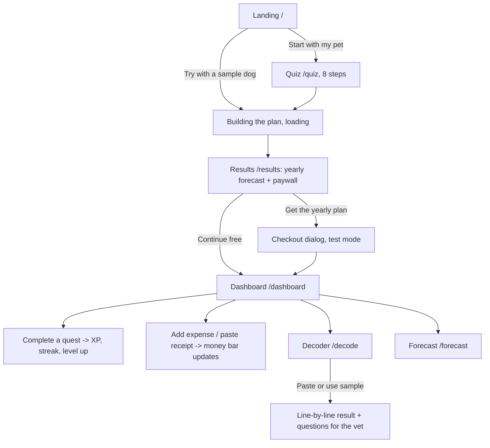

# Pet&GO: project spec

This file is the single source of truth for the team and for every AI coding session.
Read it fully, together with CLAUDE.md (engineering rules), before writing code.
If this file and CLAUDE.md disagree on product behavior, this file wins. On engineering
practice (layering, tests, migrations, Docker), CLAUDE.md wins.

Repo: https://github.com/dastanissatay/Pet-GO (public)
Design canvas: https://claude.ai/artifact/XDcs4TA9jvFHkTnG7rur6H (page "Web app · desktop"
is the main design; page "Mobile layout · 390px" is the same app at phone width)

---

## 1. Context: what we are building and why

**Event:** Business Cup 2.0 hackathon (AIESEC x Zimran x Nazarbayev University).
**Deadline:** 12:00 on Nov 15, 2026 (Asia/Qyzylorda). Resubmission is allowed until then.

**Case brief:** build a web product that closes a fundamental pain for adults in the US,
one they will pay for.

| Constraint | Requirement |
|---|---|
| Audience | **US residents aged 25-45**: working adults with jobs, families, bills and goals |
| Model | B2C only |
| Platform | **Web app only.** Runs in the browser, desktop first, must also work on a phone browser. No native apps |
| Track | **Money** ("Earning, spending, saving, owing. Where does money hurt?") |
| Time | 24 hours from idea to working product |

**Pass/fail rules:** B2C only, web only, all three submission items present
(pitch deck PDF up to 10 slides, live production link, public GitHub repo).
The production link must work end to end with **no sign-up or login**.

**How we are judged:**

| Weight | Criterion | What it means for the build |
|---|---|---|
| 40% | Does it work? | End to end in production. Core value is real, not faked. UX and code quality count; the jury reads the repo |
| 20% | What do we sell? | Clear what the user pays for and why they come back tomorrow |
| 15% | Who do we sell to? | One clear problem, deep understanding of one user |
| 15% | Why does it make money? | Big or growing niche, path to $100M ARR, LTV > CAC |
| 10% | Is it new? | Not a copy of an existing business |

---

## 2. The problem

**One user:** a US dog or cat owner aged 25-45 with a job and a budget, who treats the
pet as family.

**One pain:** vet costs are unpredictable and opaque. The owner is handed an estimate
they cannot read, has no idea whether the prices are normal, and feels that questioning
it means failing the pet. The result is surprise bills and debt.

**Evidence (cite these in the deck):**
- US pet spending was $158 billion in 2025, across 95 million pet-owning households (APPA, 2026).
  https://citizenshipper.com/blog/press-room/whats-the-cost-to-own-a-pet/
- 39% of owners have gone into debt for pet medical care (same source).
- 62% say they would go into debt to save their pet's life (Morning Consult for Money.com / Healthy Paws, Apr 2026).
  https://www.healthypawspetinsurance.com/pet-insurance-research/love-vs-limits-the-new-economics-of-pet-care.html
- 29% of Gen Z and Millennial owners are in debt because of pet costs; 83% of owners say
  the pet feels like their own child (Harris Poll, Jul 2026). https://theharrispoll.com/?p=28794
- Only 7% of consumers would cut pet health spending when money is tight, versus 33% who
  would cut digital subscriptions (Elanco survey, Nov 2026).
  https://www.dvm360.com/view/consumers-say-pet-health-is-the-last-expense-theyd-cut-survey-finds

**Why existing options fall short:**
- Pumpkin's Pet Health Predictor forecasts costs but is a free lead-in to insurance, with no daily habit.
- FareVet compares clinic prices but does not explain an estimate you already hold.
- Wiglo, BestPaws and similar apps gamify pet care but ignore money.
- Woofz is dog training, not finance.

---

## 3. The product

**Name:** Pet&GO. Use exactly this spelling in the UI, deck and README.

**One line:** the money co-pilot for pet owners. Know what your pet will cost, understand
every vet estimate, and build the habits that keep costs down.

**Free plan:** yearly cost range by category, **1 estimate decode**, daily care quests,
expense tracking.
**Paid plan (what the user pays for):** unlimited estimate decoding, the month-by-month
forecast, every daily and weekly quest.
**Why they come back:** the pet avatar grows with daily and weekly care quests; expenses
update the forecast.
**Pricing to test:** $59.99 per year (default, "save 50%", "$5.00 a month") or $9.99 per month.
Checkout is a **test-mode demo**: no card fields, nothing is charged, clearly labeled.

### US market requirements (apply everywhere)
- US English: "color", "veterinarian", "ZIP code".
- Currency: USD only, formatted `$1,240` (cents only where the user typed them).
- ZIP code: 5 digits, validated with `/^\d{5}$/` on client and server.
- Weight in lb. Dates shown as `MM/DD/YYYY`.
- Price data: US sources only, every row with a source URL.
- Copy: direct, warm, plain English for a busy adult aged 25-45. No teen slang, no jargon.
- Terms the user knows: "vet estimate", "treatment plan", "pet insurance", "deductible",
  "wellness exam".

### Non-negotiable rules
1. No sign-up or login anywhere. Users are identified by an anonymous device ID (section 7).
2. Nothing faked. Demo buttons load sample *input* from the API, then call the real API.
3. Price ranges come only from `backend/app/data/prices.json`. The LLM never invents a price.
   No match means `range: null`, verdict `unknown`, and the text "No reference range".
4. The app explains costs. It never gives veterinary or medical advice. The decoder
   always shows: "This is cost information, not veterinary advice."
5. No "money saved" number unless it is computed from user-entered data.
6. Desktop first (1280-1440px), and every page must work at 375px.
7. Every API call has a loading state and an error state with retry. Never a blank screen.

---

## 4. User flow and the jury demo path

**The 60-second demo path (must never break):**
Landing -> "Try with a sample dog" -> forecast -> Continue free -> dashboard -> complete a
quest -> Decode -> "Use sample estimate" -> line-by-line result.

---

## 5. Pages (see the design canvas for every state)

| Route | Page | Notes |
|---|---|---|
| `/` | Landing | Top nav, hero (avatar + sample decoded receipt), 3 stats with sources, 3 features, pricing (Free / Yearly / Monthly), footer with disclaimer |
| `/quiz` | Quiz | 8 steps, one question per step, progress bar, Back and Exit. Desktop: question left, "Biscuit so far" answers card right. Auto-advance on single-choice steps |
| `/results` | Results | Loading step "Building [name]'s plan…" (real API call), big range, category list with source links, paywall card on the right, "Continue free" |
| dialog | Checkout | Over results. Test mode label, plan summary, "Confirm yearly plan", "Switch to monthly" |
| `/dashboard` | Dashboard | App shell with left sidebar. Pet card (avatar, level, XP bar, streak), today's quests + this week's quest, money card (spent vs expected range bar), expenses table, decoder entry card. First-visit variant with welcome banner and empty states |
| dialogs | Add expense, Paste receipt, Level up | Over the dashboard |
| `/forecast` | Forecast | App shell. Expected / spent / still expected, month-by-month chart (paid), category rows with spent vs range and source links |
| `/decode` | Decoder | App shell. Left: estimate textarea, "Decode estimate", "Use sample estimate". Right: explainer, then loading skeleton, then result. Result: summary counts, line-by-line receipt with verdict stamps, "Worth a question" cards, "Copy questions", "Save as expense". Error state when no prices found. Disclaimer always visible |
| `*` | 404 | "This page wandered off" |

**Quiz steps:** 1 Dog or cat · 2 Name · 3 Breed (search + "Mixed / not sure") · 4 Age
(stepper + quick chips) · 5 Size, dogs only (Small under 20 lb, Medium 20-50 lb, Large over
50 lb) · 6 ZIP code · 7 Pet insurance (Yes / No / "I'm not sure" saves as No) · 8 Biggest
worry (Surprise bills / Monthly costs / Not sure what's normal).

**Redirects:** no pet for this device on `/dashboard`, `/forecast` or `/decode` -> `/quiz`.

**Sidebar (app shell):** Pet&GO logo, Home, Decode an estimate, Yearly forecast, mini pet
card, plan card with "Upgrade · $59.99/yr" (hidden on paid plan). Below 900px it stacks
above the content as a top bar.

---

## 6. Design system ("Bold and playful", chosen)

**Feel:** bold, friendly, a little cheeky, still trustworthy with money. Thick ink outlines,
hard offset shadows, sticker-like chips and stamps.

| Token | Value | Use |
|---|---|---|
| `butter` | `#FFF1D6` | page background |
| `ink` | `#161616` | text, all borders, offset shadows |
| `surface` | `#FFFFFF` | cards, inputs |
| `coral` | `#FF6B4A` | primary button, "Above" stamp, streak chip |
| `sun` | `#FFD84D` | XP, focus ring, highlights, active nav item |
| `mint` | `#9EE6BE` | "Within" stamp, success, pet card |
| `lilac` | `#D9CCFF` | decoder cards, completed quests |
| `sky` | `#A9D8FF` | "Below" stamp, illustrations |
| `muted` | `#4A4A4A` | secondary text |
| `error` | `#B3261E` | field errors only |

- **Fonts (Google Fonts):** headings and all money amounts in Bricolage Grotesque 800;
  body in DM Sans 400/500/700; estimates and receipts in Space Mono 400/700.
- **Type scale (desktop):** display 72, h1 44-52, h2 24-30, body 16-18, small 13-14.
- **Shapes:** borders always 2px ink (3px on a selected option or invalid field).
  Radius 14 small controls, 16-18 buttons and inputs, 22-28 cards, 999 pills.
  Hero cards: `box-shadow: 4px 4px 0 ink` (6px on big ones). Flat cards: no shadow.
  Dashed 2px border for empty states and hints.
- **Buttons:** one coral primary per view; white secondary; min height 48 (56-60 for main
  actions). Pressed: translate 3px and shrink the shadow. Focus: 3px sun outline, 3px offset.
- **Verdict stamps:** Space Mono 700 caps with a text label always: WITHIN (mint),
  ABOVE (coral, tilted -4deg), BELOW (sky), NO RANGE (white, dashed border, tilted 3deg).
- **Avatars:** inline SVG, 3 stages each for dog (Puppy / Growing pup / Good dog) and cat
  (Kitten / House cat / Top cat). Stage 2 adds a coral bandana, stage 3 adds a medal.
- **Motion:** tap 120ms; quest done: "+10 XP" chip floats up, XP bar fills 300ms;
  level up: avatar pops in with confetti 600ms. All off under `prefers-reduced-motion`.
- **Layout:** marketing pages max width 1200px; app pages = 248px sidebar + fluid content
  with a 2-column card grid that collapses to one column below ~900px.

Map these tokens into Tailwind theme / CSS variables in `index.css`. No hex values in components.

---

## 7. Technical design

**Stack (from CLAUDE.md):** React 18 + TypeScript + Vite + React Router + TanStack Query +
Tailwind + shadcn/ui + react-hook-form + zod · FastAPI + Pydantic v2 + SQLAlchemy 2 async +
asyncpg + Alembic · PostgreSQL 16 · Docker compose · uv · pnpm.

### Identity without login
- On first load the frontend creates a UUID v4 and stores it in `localStorage["petgo:device"]`.
- Every API call sends header `X-Device-Id: <uuid>` (added once in `lib/api.ts`).
- Backend `get_current_user` reads the header, validates it is a UUID, and upserts a
  `users` row (`device_id` unique). Missing or invalid header -> 400 `DEVICE_ID_REQUIRED`.
  This is the only place real auth will plug in later.

### Data model (Postgres)
| Table | Key columns |
|---|---|
| `users` | id, device_id (unique), plan (`free`/`monthly`/`yearly`), created_at, updated_at |
| `pets` | id, user_id FK, name, species, breed, age_years, size_class (null for cats), zip, insured, worry |
| `expenses` | id, pet_id FK, spent_on (date), amount (Numeric 10,2), category, note |
| `quest_completions` | id, pet_id FK, quest_id, period_key (`2026-11-14` daily or `2026-W46` weekly), xp; unique (pet_id, quest_id, period_key) |
| `decodes` | id, user_id FK, pet_id FK, total_charged (Numeric), result (JSONB) |

XP, level and streak are **computed** from `quest_completions` (no counters to drift).
One pet per user for now (UI assumes it; schema allows more).

### Reference data (read-only JSON in `backend/app/data/`, validated with Pydantic at startup)
- `prices.json`: `{id, name, aliases[], species: dog|cat|both, low, high, category, routine, source_url}`
- `multipliers.json`: species / size / age-band multipliers for the forecast
- `quests.json`: `{id, title, cadence: daily|weekly, xp, species, related_price_id, why}`
- `breeds.json`: dog and cat breed names for the quiz search
- `samples.json`: sample pet, sample vet estimate text, sample receipt text

### API (all under `/api/v1`, header `X-Device-Id` required except health)
| Method + route | Body | Returns |
|---|---|---|
| `GET /me` | | `{plan, free_decodes_left}` |
| `GET /samples` | | `{pet, estimate_text, receipt_text}` |
| `GET /breeds?species=dog&q=lab` | | `{items, total}` |
| `POST /pets` | `PetCreate` | `PetRead` 201 |
| `GET /pets/current` | | `PetRead` or 404 `PET_NOT_FOUND` |
| `PATCH /pets/{id}` | `PetUpdate` | `PetRead` |
| `GET /pets/{id}/forecast` | | `Forecast {total_low, total_high, items[{category, low, high, note, source_urls}], monthly[12]}` (`monthly` only on paid plan, else null) |
| `GET /pets/{id}/progress` | | `{xp, level, stage, next_level_xp, streak}` |
| `GET /pets/{id}/quests?local_date=YYYY-MM-DD` | | `{daily[], weekly[]}` each with `completed`, `typical_cost` |
| `POST /pets/{id}/quests/{quest_id}/complete` | `{local_date}` | `{progress, leveled_up}` |
| `DELETE /pets/{id}/quests/{quest_id}/complete?local_date=` | | 204 (undo) |
| `GET /pets/{id}/expenses?limit&offset` | | `{items, total}` |
| `POST /pets/{id}/expenses` | `ExpenseCreate` | `ExpenseRead` 201 |
| `DELETE /pets/{id}/expenses/{expense_id}` | | 204 |
| `GET /pets/{id}/summary` | | `{spent_total, expected_low, expected_high, still_low, still_high}` |
| `POST /receipts/parse` | `{text}` | `ExpenseDraft {amount, spent_on, category, note}` |
| `POST /estimates/decode` | `{pet_id, text}` | `DecodeResult {lines[], total_charged, summary, counts}`; 402 `DECODE_LIMIT_REACHED` on free plan after 1; 422 `NO_PRICES_FOUND` |
| `POST /subscriptions` | `{plan: monthly|yearly}` | `{plan}` (test mode, no payment) |
| `GET /api/health` | | 200, checks DB |

`EstimateLine = {raw_text, description, charged, matched_id, range: {low, high} | null,
verdict: within|above|below|unknown, explanation, question_for_vet | null, source_url | null}`.
Verdict rule (code, never LLM): `above` if charged > high, `below` if charged < low,
`within` otherwise, `unknown` if no match. A failed decode does not use the free decode.

### Decoder pipeline (`features/estimates`)
1. LLM extracts line items as strict JSON `[{raw_text, description, charged}]`. Validate with
   Pydantic, retry once. If the LLM is down or the key is missing, fall back to a regex parser
   (lines with a `$` amount) so the demo never dies.
2. Code matches each item to a `prices.json` row (normalize, aliases, `difflib` similarity,
   species filter). Below the threshold = no match.
3. Code computes the verdict.
4. LLM writes a one-sentence explanation and an optional polite question for the vet, given
   only the item, the charged amount and the range. On failure, use templated text.
LLM: Anthropic Messages API over `httpx.AsyncClient` with a timeout. Env: `LLM_API_KEY`,
`LLM_MODEL` (default `claude-haiku-5-5`). Never log estimate text.

### Game rules
- Levels: stage 1 at 0 XP, stage 2 at 100 XP, stage 3 at 300 XP.
- Daily quest 10 XP, weekly quest 30 XP. A daily quest once per local day, weekly once per ISO week.
- Streak: consecutive local days with at least one completed quest, counted back from today
  (or yesterday if nothing yet today).
- `local_date` comes from the browser and must be within 1 day of server UTC date.

### Deployment
- Production = `docker-compose.prod.yml` on one small Linux VPS with Caddy in front for
  automatic HTTPS. nginx in the frontend image serves the SPA and proxies `/api` to backend.
- Postgres port not exposed. Migrations run with `make migrate` after deploy.
- Fallback if the VPS fails: Render (Docker web service + managed Postgres).
- `.env` only on the server. The repo is public: never commit keys.

---

## 8. Ownership (avoid merge conflicts)

| Person | Owns |
|---|---|
| 1 · Frontend | `frontend/` scaffold, theme, app shell, landing, quiz, results, checkout, dashboard, dialogs, forecast, 404, error boundary |
| 2 · Backend platform | repo root (compose, Makefile, `.env.example`, CLAUDE.md), `backend/` scaffold, core, users/device ID, pets, forecast, quests, expenses, summary, subscriptions, samples/breeds endpoints, Docker, deploy |
| 3 · Decoder + data + launch | `backend/app/data/*.json` research, `features/estimates` and `features/receipts` (backend), `frontend/src/features/decode/` (UI), pitch deck, README |

Branches: `feat/<area>`, small PRs merged to `main` often. Run `make gen-api` after any
schema change and commit the generated types.

## 9. Out of scope
Accounts, bank connections, insurance purchase, real payments, native apps, push
notifications, photo OCR (paste text only), multiple pets UI. These go on one "What's next" slide.

## 10. Definition of done
- [ ] Production link opens in an incognito window with no login, on a phone and a laptop
- [ ] Demo path in section 4 works end to end against the real API
- [ ] "Start with my pet" works with a real breed and ZIP code
- [ ] Decoder works on the sample and on a hand-typed estimate; disclaimer visible
- [ ] Every price shown traces to a row in `prices.json` with a source URL
- [ ] USD, ZIP validation and US English everywhere
- [ ] No API key in the repo; repo public; README explains setup and architecture
- [ ] Deck exported as PDF, 10 slides or fewer, covering all five criteria
